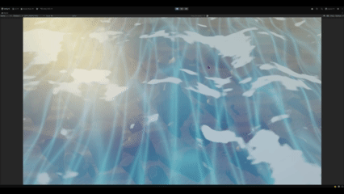
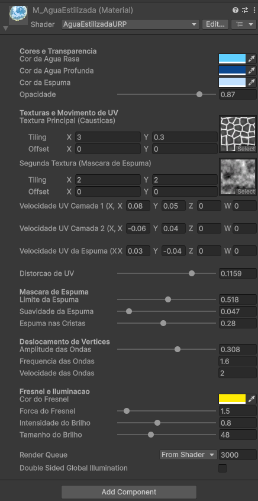
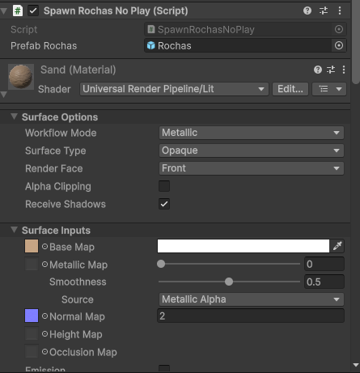

# README — Trabalho Final: Água Estilizada

**Nome:** Lucas Bragança Lima dos Santos Alves

**Versão do Unity:** 6000.3.6f1 (Unity 6.3)

**Pipeline de renderização:** Universal Render Pipeline (URP) 17.3.0

**Cena principal:** `Assets/Scenes/ÁguaEstilizaada.unity`

---

## Gravação de tela do shader

## Instruções

1. Abra o projeto `Shader_Final` pelo Unity Hub com o editor 6000.3.6f1.
2. Abra a cena `Assets/Scenes/ÁguaEstilizaada.unity`.
3. A água já se anima na cena. Ao apertar **Play**, as rochas são instanciadas pelo script `SpawnRochasNoPlay`.
4. Para testar o visual, selecione o objeto **AguaEstilizada** e altere os parâmetros do material `M_AguaEstilizada` no Inspector.

O shader é `Assets/Shaders/AguaEstilizadaURP.shader` e só funciona em URP.

## Descrição do efeito

Água estilizada translúcida sobre um fundo de areia com rochas. O shader (ShaderLab + HLSL, com vertex e fragment shader) combina:

- **Ondas:** deslocamento de vértices com seno e cosseno em função do tempo (`_Time.y`).
- **Cáusticas e espuma:** duas texturas animadas por movimento e distorção de UV; a segunda funciona como máscara de espuma, com limite e suavidade ajustáveis.
- **Fresnel:** cor mais clara nas bordas, conforme o ângulo de visão.
- **Iluminação:** brilho especular com a luz direcional.
- **Transparência:** blending alfa, com a espuma mais opaca que a água.

Os parâmetros ficam expostos no material, então o visual muda sem editar o código.

## Parâmetros no Inspector

Material da água (`M_AguaEstilizada`):

Material da areia (`Sand`) e script das rochas:

## Créditos e referências

- **Texturas da água** (`T_Agua_Causticas.png` e `T_Agua_MascaraEspuma.png`): geradas com o Gemini (Google).
- **Material da areia** "Rippled Wet Sand": [Poliigon](https://www.poliigon.com/texture/rippled-wet-sand-texture/6997)
- **Rochas** "Free Pack Rocks Stylized": [Unity Asset Store](https://assetstore.unity.com/packages/3d/environments/free-pack-rocks-stylized-316250)
- **Documentação consultada:** Unity (ShaderLab, Built-in shader variables, URP: writing shaders), Microsoft HLSL reference e o guia da atividade.
- **Código:** shader e scripts escritos por mim, a partir do exemplo do guia.
